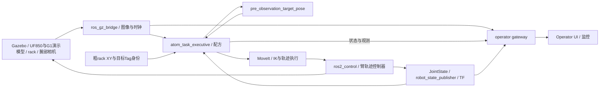
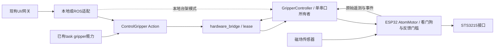

# ATOM 当前系统架构

> 2026-10-07 main 同步：当前位置命令使用连续 MOVE，人工微调仍使用 JOG；普通 STOP/cancel 在确认保持后允许恢复，实际故障仍受门槛约束。Linux Jazzy 构建及假串口 ROS Action 联调已有通过记录，前端实物接入有用户反馈；接触/力标定、带物体停止与机械臂联合任务仍未验收。

更新：2026-10-07。依据当前工作区代码与既有记录汇总；本文区分默认视觉仿真、独立Observe控制和夹爪硬件接入。原2026-09-30运行图与讲解保存在 [历史快照](experiments/SYSTEM_ARCHITECTURE_SNAPSHOT_20260930.md)。当前能力验收见 [PROJECT_STATUS](PROJECT_STATUS.md)，未来结构见 [roadmap](architecture/SYSTEM_ARCHITECTURE_ROADMAP.md)。

## 1. 默认视觉仿真路径

`task_executive` 在同一个ROS node内组合 perception、planning/motion、tasks、gripper、simulation 和 telemetry Python能力；这些模块不是各自新增一个node。旧 `pre_observation_demo` 为兼容入口，不能当作另一套生产实现同时启动。粗rack XY、Tag尺寸/间距、时钟和配置还含仿真假设，不能直接驱动物理系统。

默认流程是预观察 → coherent rack/目标Tag确认 → 对齐 → 有界重对齐（需要时）→ 接近。完整取放还缺接触闭合、稳定夹持、附着/持有、放置和释放证据。固定目标 `transfer_demo` 是另一个纯臂运动基线，其模拟抓取成功不代表当前rack中的试管被搬运。

感知模块采用同帧多Tag RGB PnP；depth模式在已明确配准的条件下用不透明tag面的深度平面辅助位姿估计，包含质量检查、回退和冲突拒绝。深度已参与目标定位，尚无透明试管直接深度识别或动态场景避障验收。详见 [相机实验](perception/CAMERA_EXPERIMENT.md) 与 [融合](perception/DEPTH_FUSION.md)。

## 2. 自有package与责任

当前 `ros2_ws/src/` 有六个ATOM自有ROS package；package、node、普通Python能力和外部进程不能按一一对应关系计数。

| package/目录 | 责任 | 当前部署边界 |
| --- | --- | --- |
| [atom_xarm_sim](../ros2_ws/src/atom_xarm_sim/) | 仿真launch、TaskExecutive、感知/运动/任务能力、基线与回归入口 | 默认视觉流程主包；真实输入/系统监督待迁移 |
| [atom_gripper_description](../ros2_ws/src/atom_gripper_description/) | 定制夹爪描述、网格和描述检查 | 参数待实测；当前G1演示模型不能替代定制夹爪 |
| [atom_xarm_description](../ros2_ws/src/atom_xarm_description/) | 官方arm与定制gripper模块化组合 | mount/TCP/碰撞还未实测验收 |
| [atom_xarm_dynamics](../ros2_ws/src/atom_xarm_dynamics/) | 可选名义执行器C++插件 | 仿真模型，非真实舵服辨识 |
| [atom_operator_interfaces](../ros2_ws/src/atom_operator_interfaces/) | ExecuteTask与ControlGripper Action定义 | 接口定义与服务端实机验收是不同条件 |
| [atom_gripper_hardware](../ros2_ws/src/atom_gripper_hardware/) | 共享串口控制、协议/标定、sensor/hardware bridge | 主机测试与Linux假串口ROS联调已有；实机系统验收待完成 |
| [tools/operator_gui](../tools/operator_gui/) | HTTP网关、图像预览、本地/ROS适配、独立仿真监督 | Python工具目录，不是额外ROS package |
| [firmware/atom_gripper_esp32](../firmware/atom_gripper_esp32/) | 本地采样、STS位置控制、限值、看门狗与故障 | 独立硬件运行时；传感器调整与接触/力验证待完成 |

官方vendor依赖和版本沿用 [Docker基线](../docker/jazzy/README.md) 与 [决策记录](DECISIONS.md)。历史13包构建报告是当时版本，不能作为新增硬件包已部署的证据。

## 3. 三种运行方式

| 方式 | 操作与运动入口 | 已有证据/限制 |
| --- | --- | --- |
| 默认视觉仿真 | 仓库脚本启动TaskExecutive配方，GUI监控 | 视觉观察/接近已有仿真结果；网页命令与完整取消/停止尚未统一到视觉流程 |
| 独立Observe控制演示 | UI → ExecuteTask → sim_supervisor → 仿真运动 | Gazebo取消/停止/复位有历史验证；独立于默认视觉执行器，不是硬件急停 |
| 独立实物夹爪台架 | 本地UI适配器或ROS hardware_bridge → 同一GripperController → ESP32 | 位置/传感器软件与台架证据已有；传感器调整后要复验，Linux假串口ROS联调已通过，前端实物接入有用户反馈，定量联合验收仍待完成 |

入口说明：[仿真运行](simulation/ARM_ONLY_SIMULATION.md)、[GUI运行](../tools/operator_gui/README.md)、[夹爪接入](gripper/GRIPPER_SYSTEM_INTEGRATION.md)。任何模式均不能让第二个运动执行器或第二个串口所有者同时控制同一设备。

## 4. 实物夹爪的独立硬件边界

两种适配模式互斥，不同时开同一个串口；独立sensor_bridge、Arduino监视器、console和sweep工具也不能与hardware_bridge争用USB。此图描述已有位置/遥测控制路径，Linux假串口ROS进程已有验证，联合实机尚待验收；接触、力与稳定夹持的新增状态机是 [Integration Plan](gripper/GRIPPER_INTEGRATION_PLAN.md) 中的未来工作。

现有 UI/ROS Close通过连续MOVE达到位置目标，不启用固件磁场CLOSE分支。force请求仍拒绝，force_n为unknown，grasp_verified为false。保持命令可能保留扭矩；停止请求不等于已确认机械停止，DISARM可能释放物体，软件STOP不是硬件急停。

## 5. 关键接口与语义

| 接口 | 作用与边界 |
| --- | --- |
| `/atom/pre_observation_target`、`/atom/pre_observation_pose` | 粗rack XY/高度 → 方位/默认半径的末端观察位姿；不是完整物体抓取目标 |
| `/atom/approach_task` | 目标Tag/架身份和任务名；pick/place名字不证明取放实现 |
| 相机Image/CameraInfo、`/tf`、`/joint_states`、`/clock` | 感知、坐标、状态和仿真时间；RGB/depth模式topic名称以对应配置为准 |
| `/atom/approach/tag_observation`、`/atom/task/status` | 观测质量、阶段、几何和结果日志 |
| MoveGroup、ExecuteTrajectory、IK/FK与FollowJointTrajectory | 现有规划/执行边界；只允许一个臂运动所有者 |
| ExecuteTask与仿真stop/reset服务 | 独立Observe监督；不能假定默认视觉流程已接同一服务端 |
| `/atom/gripper/control`、`/atom/gripper/control_heartbeat` | ControlGripper与会话lease；调用者丢失请求保持，不自动张开 |
| `/atom/gripper/status`、`/atom/gripper/magnetic_field`、`/diagnostics` | 原始反馈与质量；ROS磁场单位T，固件/本地显示µT，raw load不是N |

完整字段与配置由 [相机实验](perception/CAMERA_EXPERIMENT.md)、[GUI接口](architecture/OPERATOR_GUI_INTERFACES.md) 和 [夹爪系统接入](gripper/GRIPPER_SYSTEM_INTEGRATION.md) 维护，本文不复制多份协议。

## 6. TF、规划场景与实机迁移

- 当前仿真规划参考 `link_eef`，不能直接把试管中心或相机螺钉位置作为抓取TCP。安装/手眼、tag-to-slot、工位/base及TCP都需测量。
- Gazebo模型出生坐标与ROS的临时world/base关系不能混用；当前粗输入/报告含明确仿真换算，不是实物定位结果。见 [Sim2Real](SIM2REAL_LOG.md)。
- Gazebo碰撞几何存在不等于MoveIt已掌握相同工位障碍或动态占据图；带物体规划需要独立对象/碰撞语义。
- 联合实机仍需真实arm driver输入、测量后的mount/TCP、统一故障与取消监督，维持单一运动所有者和独立硬件停止回路。
- 传感器调整后基线/模型按revision复验；本地接触证据、稳定夹持、抬升/持有、释放分别验收。仿真成功不可解除实机gate。
- Vendor arm、定制夹爪与未来移动底盘保持独立描述；详细CAD为机械源，碰撞/惯性使用经验证的简化模型与测量。

## 7. 开发入口与未来边界

| 工作 | 代码入口 |
| --- | --- |
| 脚本/部署 | [scripts/atom.sh](../scripts/atom.sh)、[operator启动](../scripts/lib/operator.sh)、[仿真launch](../ros2_ws/src/atom_xarm_sim/launch/uf850_arm_only.launch.py) |
| 视觉配方/能力 | [executive](../ros2_ws/src/atom_xarm_sim/atom_xarm_sim/tasks/executive.py)、[recipes](../ros2_ws/src/atom_xarm_sim/atom_xarm_sim/tasks/recipes.py)、[perception](../ros2_ws/src/atom_xarm_sim/atom_xarm_sim/perception/) |
| 夹爪硬件 | [controller](../ros2_ws/src/atom_gripper_hardware/atom_gripper_hardware/controller.py)、[hardware_bridge](../ros2_ws/src/atom_gripper_hardware/atom_gripper_hardware/hardware_bridge.py)、[固件](../firmware/atom_gripper_esp32/motor_control.h) |
| 系统/UI | [GUI目录](../tools/operator_gui/)、[gripper能力](../ros2_ws/src/atom_xarm_sim/atom_xarm_sim/gripper/control.py)、[验证能力](../ros2_ws/src/atom_xarm_sim/atom_xarm_sim/gripper/verification.py) |

能力拆分规则以 [MODULES_AND_TASKS](architecture/MODULES_AND_TASKS.md) 为准：先组合已有capability/recipe；新增node需独立运行/接口边界的理由。新抓取任务不单独生成一套感知、规划或控制实现。尚未实施的独立能力服务、系统任务/安全统一、实物取放和移动扩展见计划与问题台账。
