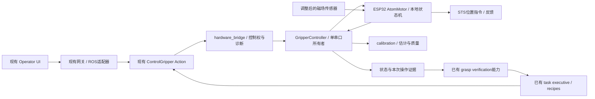
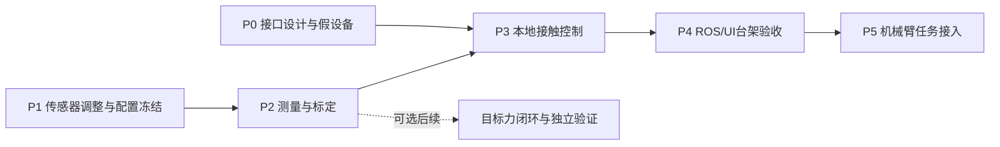

# 夹爪 Integration Plan：传感器调整后的接触与任务接入

> 2026-10-07 main 同步：当前位置命令使用连续 MOVE，人工微调仍使用 JOG；普通 STOP/cancel 在确认保持后允许恢复，实际故障仍受门槛约束。Linux Jazzy 构建及假串口 ROS Action 联调已有通过记录，前端实物接入有用户反馈；接触/力标定、带物体停止与机械臂联合任务仍未验收。

日期：2026-10-06。状态：**拟实施计划，尚未实施或实机验收**。

用户已说明末端传感器仍需调整。本计划以传感器装配/配置尚未冻结为前提：现在可以推进接口、假设备和回放联调；实物接触闭合、力控制和机械臂带物体任务按下述验收门槛逐步开放。具体调整是安装、磁体、接线还是更换型号尚未确定，因此不预选新传感器或库。

## 1. 目标与已有基础

首个目标是：**在台架上由明确命令触发有界闭合，检测到经过验证的接触后停止并确认保持，再通过现有 ROS/UI 接口返回可核对的结果。** 后续再接入机械臂抬升、运输、放置和释放。

参考旧代码的三轴基线、磁场差值、接触停止、请求/完成分离和速度/电流诊断；保留我们当前的位置模式、单串口所有者、反馈检查、心跳、故障锁定与人工复位。旧代码的 wheel mode、PI 增益、引脚、负载触边标定和磁场阈值不作为新配置依据。源代码证据见 [旧代码审查](LEGACY_GRIPPER_CODE_REVIEW.md)，原 GitHub 快照为 `e870e23d632f910f58638850cd3fd7d1b3b07a66`。

| 当前基础 | 本计划的使用方式 | 实机边界 |
| --- | --- | --- |
| ESP32 采样、ZERO、位置 JOG、限值、看门狗、故障日志 | 在现有 `AtomMotor` 内扩展可中断的接触状态机 | 传感器无效时不放宽 ARM/运动门槛 |
| `GripperController`、ROS `ControlGripper`、operator UI | 扩展已有协议/命令及状态；继续一个串口所有者 | ROS/UI 进程联调、取消和实物停止仍需验收 |
| 当前 UI/ROS Open/Close | 保留为空载位置调试入口，界面明确标为位置动作 | Close 只是到位，不是自动抓取；不用于未验收物体夹持 |
| 已有 `gripper/control.py`、`verification.py`、task recipes | 组合观察、接近、接触、验证、转运和释放 | 真实输入、TF/TCP 和系统监督尚未验收 |
| `calibration.py` 的未标定模型 | 接入传感器调整后独立验证的模型与版本 | 当前 force_n 未知，force 请求仍拒绝 |

2026-10-03 空载扫测是旧装配条件下的位置证据，不能作为调整后传感器的接触/力验收。没有修改机械机构时可作为回归对照；若手指、滑轨、线缆受力或装配同时改变，位置和负载包络也须复测。详见 [验证日志](GRIPPER_VALIDATION_LOG.md)。

## 2. 模块与数据路径



图中接触控制与夹持验证是拟扩展能力。ROS 图复用当前硬件桥和任务节点；没有新增任务专属 node。Windows 本地 UI 调试可通过现有本地适配器直接接同一个 controller，与 ROS 部署互斥。新增实验/回归脚本只调用共享实现。

ESP32 负责连续采样、信号有效性、本地接触停止与动作边界。主机负责请求/回执核对、日志、控制权、标定结果展示和任务组合。将来若启用目标力闭环，MCU 必须拥有经验证的模型/参数；不能只在主机显示 force_n，却在 MCU 用不一致的磁场阈值宣称力控制。

## 3. 阶段、依赖与退出条件



**P0 可以立即开始。** P1–P2 等待实际传感器调整与测量；P3 的代码可用假设备先开发，但实物运动必须满足 P1–P2 的门槛。目标力 PI 不属于首个接触闭合里程碑，也不能代替 P3–P5 的验收。

| 阶段 | 工作与交付物 | 退出条件 | 对应既有 TODO |
| --- | --- | --- | --- |
| **P0：接口与假设备** | 明确位置/接触/稳定夹持/释放语义；设计操作 ID、事件和能力查询；扩展现有 FakeDevice 与回放夹具；定义 UI 展示和任务 gate | 能在假设备中跑通正常/故障/取消路径；旧固件缺少新能力时拒绝新命令；模拟证据不能开启实机任务 | G04/G08/G09 的软件准备 |
| **P1：调整与冻结** | 确认调整内容，记录传感器/载板/磁体/安装方向与间距、接线、地址、库/固件版本；检查重复装配、线缆影响、饱和/无效样本和只读采样 | 配置有唯一 revision；当前安装下可重复取得有效数据；失效/复位行为有记录。数据质量不满足要求就回到调整 | G01/G02/G06 |
| **P2：测量与标定** | 采空载静止/开合/通电变化，以及独立力参考下的加载/卸载/重复装配数据；测开口–编码器、端点、负载、速度/停止响应；形成接触参数和力模型验证报告 | 接触与空载变化可区分；试件允许力/变形和停止超调有独立证据；参数包具有适用范围/失效规则。不能区分就改装配或观测方式，不提高阈值掩盖问题 | G01/G02/G03/G05/G06 |
| **P3：MCU 接触闭合** | 在 AtomMotor 内加入显式状态、独立滤波/持续判定、可中断闭合、保持确认、终止原因；先使用有界位置模式，所有 motion/fault gates 保留 | 台架接触、无物体、过载、传感器失效、STOP/失联均在规定包络内结束；无物体不得报告夹持成功；保持失败标为未知/失败 | G04/G05/G09 |
| **P4：ROS/UI 台架接入** | 扩展 controller/bridge/Action/UI；核对操作 ID、事件、单位、配置版本；验收控制权、取消、页面/进程掉线和重启 | 实际 ROS 构建与假串口进程联调通过，再完成真实夹爪台架验证；UI 状态与原始记录一致，旧事件不解除新故障 | G06/G08/G09 |
| **P5：机械臂任务** | 测 TCP/安装 TF 与碰撞模型；验收真实 arm 输入和统一监督；组合接近、抓取、验证、抬升、运输、放置、释放 | 每步都有本次操作的新鲜证据；任一步失败均阻断后续，系统停止策略实测；仿真成功不可替代实物验收 | G07/G08/G09 |

计划按门槛推进，不承诺固定日期。下一阶段是否开放由配置和验收记录决定，不能仅凭启动参数设为 true。

## 4. 接口与状态机设计草案

以下字段、命令与状态均是拟实施契约，当前代码尚不支持。

### 操作语义

| 操作/结果 | 拟定语义 | 可授权的下一步 |
| --- | --- | --- |
| 现有 `open/close/move` + `position_verified` | 达到编码器目标；仍不提供物体证据 | 下一次台架位置操作 |
| 新 `grasp` + `contact_verified` | 本次闭合内检测到合格接触，并确认停止；到达最大闭合边界仍无接触则失败 | 保持与稳定夹持验证；不直接抬升 |
| `grasp_verified` | 本次对象/操作的接触、保持、滑移与质量证据满足已定义的验证策略 | 允许受监督的小幅抬升验证；成功后才允许转运 |
| 新 `release` + `release_verified` | 对象已在目标支承上，受控张开并取得释放证据 | 机械臂撤离；单凭编码器张开不充分 |
| 现有 `force` | 校准量程内的目标力请求，只有 MCU 力闭环与模型验证后支持 | 经独立验收的力控制任务；否则拒绝 |

`grasp/release` 拟扩展现有 ControlGripper 命令白名单，不新增 Action server/node；优先使用服务器侧已验收的配置包，避免由 UI 任意下发阈值。新增结构化结果 `contact_verified/release_verified` 和操作标识时，需要同步修改 `.action`、所有客户端及构建产物，不将 machine-readable 状态只塞进 message 字符串。具体 schema 在 P0 定稿。

保持 V1 原始磁场数据的现有单位/字段；运动与接触事件拟增加 `operation_id`、`device_ms`、配置 revision、起止位置、信号质量、接触状态及终止原因。主机接收时间另记，不能视为已同步的传感器时间。启动时查询协议/支持命令/配置版本；旧固件仍可走原位置协议，新接触请求必须拒绝，不能降级成位置 Close。

### 本地状态

```text
DISARMED → ARMED_IDLE → CLOSING → CONTACT_STOPPING → HOLDING
HOLDING → RELEASING → ARMED_IDLE
任一运动状态 → STOPPING 或 FAULT_LATCHED
```

- `CLOSING` 只由明确 grasp 请求进入。局部有界位置目标和速度由测量确定；不使用一个指向硬限位的大目标再依赖主机及时叫停。
- 每次接触判定须绑定新鲜有效样本、当前操作 ID 与配置 revision。滤波采用独立状态；基线、滤波历史与持续判定在操作/配置切换时按规定重置。
- `CONTACT_STOPPING` 核对停止回执及反馈；零速度/保持命令被接受不等于实际已停止。`HOLDING` 只是本地保持状态，不能自动等于 grasp_verified。
- STOP 不隐式重新开始或张开；release 后不重新闭合。FAULT_LATCHED 需人工检查和明确恢复流程，不自动复位/重放命令。
- 基线/模型失效、样本过期、ADC/磁场饱和、舵机反馈错误或动作边界触发时，停止新的闭合，按已验证策略请求保持并锁定故障。无法确认保持时返回 unknown/failure。软件停止不是硬件急停，掉电保持能力必须实测。

### 夹持验证与机械臂 gate

复用 `gripper/verification.py`，但实机路径要扩展为对象/操作关联、新鲜度和质量检查。当前单个 Bool 以及 `simulate_grasp_success` 都不足以提供实机验证：旧 true、不同对象或重复操作不能通过新任务。

保持阶段至少定义并验证接触持续性、反馈稳定性及滑移/掉落观测。具体传感器组合和阈值在 P2/P3 决定；若调整后的单个磁场传感器无法区分可靠持有与滑移，增加经论证的观测证据，而不是仅延长等待时间。抬升后持续监测，新鲜度失效或夹持丢失立即阻断后续运输。

## 5. 配置、实验与验收记录

每份标定/接触参数包绑定：传感器与磁体身份、安装 revision、轴向/间距、手指和垫片配置、库/固件版本、采样/滤波设置、供电条件、有效位置/温度/力范围、基线策略、拟合/验证数据及不确定度。零点变化不自动更新模型；更改磁体、安装、传感器、增益或滤波后，旧包失效，重新完成对应阶段。

基线先检验是否需要位置/温度相关补偿，再决定模型。保留三轴原始数据；差值模长失去方向信息，不能预设其足以解释指尖力。即使接触模式只用磁场阈值，其物体试验也要用独立力参考确定允许载荷与超调；向 UI 输出 N 或启用 force 请求还需要完整的力模型验证。

P2 开始前填写以下实验目标；暂不填具体数值，避免把旧值当作验收标准：

| 必须定义的量 | 单位/证据 | 未确定时限制 |
| --- | --- | --- |
| 试件、单指/总夹持力定义、允许力与变形 | N、mm；试件规格/独立测量 | 不启用带物体自动闭合 |
| 接触信号区间、滤波、迟滞与持续时间 | µT、样本数/ms；空载与加载分布 | 不开放 grasp |
| 最大闭合位置/开口、速度及额外闭合距离 | counts、mm、counts/s 或已核实物理速度；重复试验 | 不扩大当前位置包络 |
| 采样最大间隔、停止/取消/失联延迟 | ms；测量条件、重复次数、最大观察值 | 不将当前约10 Hz/看门狗配置视为时序保证 |
| 保持时间、滑移、释放及任务成功条件 | s、mm、对象/操作证据 | 不开放抬升/运输/撤离 |
| 每种条件的试验次数、误触发/漏检、模型误差 | N次、比率、N与不确定度；独立验证集 | 不声明可靠性或力精度达标 |

## 6. 软件改动位置与验证矩阵

| 现有位置 | 拟改动 |
| --- | --- |
| `firmware/atom_gripper_esp32/board_config.h` / `.ino` | 只按实际调整更新采样适配；读取状态、时间、质量。更换型号时仍向控制层输出一致的有效样本契约 |
| `motor_config.h` / `motor_control.h` | 合格参数与本地状态机、接触/停止证据、操作 ID；缓存速度/电流诊断；保留位置模式和全部 fault gates |
| `atom_gripper_hardware/protocol.py` / `controller.py` / `calibration.py` | 协议能力查询、事件关联、配置匹配、取消与结果核对；模型范围/不确定度和失效处理 |
| `hardware_bridge.py` / `ControlGripper.action` | 扩展结构化命令/结果，原有 lease/单串口所有权继续适用；替换当前硬编码 grasp_verified=false 必须由验证证据支撑 |
| `tools/operator_gui/` | 清晰区分位置与接触动作；显示 adjustment/calibration pending、阻断原因、接触/夹持/释放/未知状态 |
| `gripper/control.py` / `verification.py` / `tasks/recipes.py` | 等待每个 Action 时处理 supervisor cancel/stop；新增能力方法组成配方，不复制规划/感知实现 |

| 场景 | 预期验证结果 | 最早阶段 |
| --- | --- | --- |
| 上电、连接、release 后空闲 | 不自动 ARM/闭合/续跑 | P0假设备，P3实物 |
| 旧固件/错误配置/未标定/仿真数据来源 | 新命令或实机任务被拒绝，force 未知 | P0/P4 |
| 无物体闭合到边界 | 无接触失败，不发 grasp_verified | P0/P3 |
| 有物体接触及噪声尖峰 | 接触停止有证据；尖峰不能直接变成稳定夹持 | P2/P3 |
| 传感器失效/过期/饱和，舵机通信/限值故障 | 停止新增闭合、故障锁定；未确认保持不得报成功 | P0/P3 |
| STOP/Cancel 在任一步、USB/调用者掉线 | 无后续动作，无自动释放或重放；测停止时序 | P0/P3/P4 |
| UI 与 task 竞争、旧回执/旧验证结果 | 单所有者；旧事件不满足新任务、不清新故障 | P0/P4 |
| 抬升前验证失败、抬升后滑移、释放失败 | 阻断运输/撤离，按已验证系统策略处理 | P5 |

假设备、回放和 Gazebo 使用明确的模拟来源标记，仅验证软件流程。ROS 进程假串口验收与真实机械臂/夹爪验收分别记录；当前历史主机测试通过不视为本计划已实现。

## 7. 机械臂配方与下一步交付

拟定首个实机配方：准备/获得控制权 → 张开并核对 → 现有观察/接近 → 机械臂停止并确认 → 接触闭合 → 稳定夹持验证 → 小幅抬升验证 → 运输 → 放置到支承并确认 → 受控释放验证 → 撤离/结束。

抬升前失败不得运输；放置/释放没有确认不得撤离。每步都响应同一个系统 supervisor 的停止/取消，继续保持机械臂单一运动所有者。TCP、碰撞、真实感知来源及故障协调通过 G07/G08 后才开放联合配方；不能直接给现有仿真 executive 打开硬件标志。机械臂描述、定制夹爪和未来底盘仍分开，不移植旧 tool0 FK node。

**现在的下一步交付：P0 接口规格、假设备/回放场景和 P1/P2 实验记录模板。** 传感器实际调整完成后，冻结 revision 并填写上述未定目标，再进入实物标定。目标力 PI 留作确定性接触基线验收后的扩展。

工程选择一旦确认写入 [DECISIONS.md](../DECISIONS.md)；调整内容/模型适用条件未明写入 [ASSUMPTIONS.md](../ASSUMPTIONS.md)；试验故障写入 [KNOWN_ISSUES.md](../KNOWN_ISSUES.md)，仿真与实物差异写入 [SIM2REAL_LOG.md](../SIM2REAL_LOG.md)。原始数据保存在独立的 `tmp/` 试验目录，需长期保留的证据按项目资产流程归档，报告置于 `docs/`。

本计划不选择新 ROS 发行版、Ubuntu、arm driver、MoveIt 配置或传感器型号。既有接口和部署方式以 [GRIPPER_SYSTEM_INTEGRATION.md](GRIPPER_SYSTEM_INTEGRATION.md) 为准，详细未完成事项仍对应 G01–G09。
