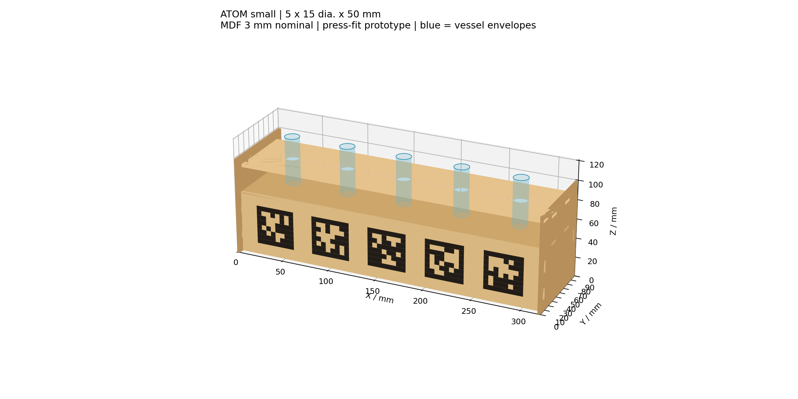
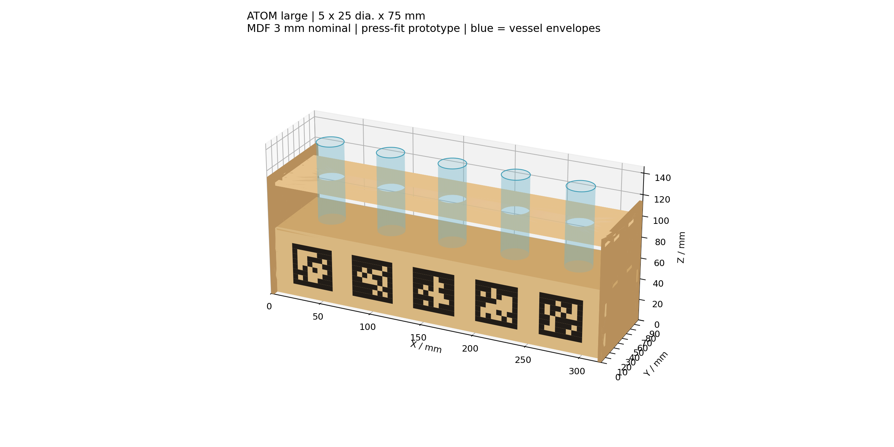

# 五孔 MDF 比色皿架：激光切割初稿

日期：2026-10-21。单位除另注外均为 mm。用户给定容器外径/高度为小号 Ø15 × 50、大号 Ø25 × 75，并确认 3 mm MDF、两款独立五孔架、每孔一个 40 mm AprilTag 的设计方向。这些是设计输入，不是测量报告。原始交接 CAD 未修改。

## 看图与文件

源目录：[source_cad/cuvette_rack/v1](../../source_cad/cuvette_rack/v1/)。先看装配图，再看尺寸图，最后用 DXF/SVG 导入加工软件。

| 文件 | 用途 |
| --- | --- |
| `small_dimensioned.svg` / `large_dimensioned.svg` | 三视图及名义尺寸；含尺寸说明，不能当切割路径 |
| `small_cut_RASTER_REVIEW.dxf` / `large_cut_RASTER_REVIEW.dxf` | 每款六块板，1:1 毫米加工路径；试切后重建方可定版 |
| 同名 `.svg` | 相同路径和实心刻蚀区域，便于矢量软件导入 |
| `*_layout.png` | 零件编号与排版核对，不用于加工 |
| `fit_and_tag_coupon_FIRST.dxf` / `.svg` | 摩擦配合及 tag 对比度试片 |
| `*_tags_PRINT_100percent.svg` | 黑白打印备用方案；整张 320 × 63，100% 输出 |
| `parameters.json` / `build_rack.py` | 可重建的设计输入和二维几何源 |
| `geometry_checks.json` | 检查结果与名义孔位、tag 坐标；不代表实物标定 |

没有输出 STL：本设计从二维板件制造。三维图由相同二维轮廓按板厚拉伸，只用于审阅。

## 结构与尺寸

每款六件：BASE 底托、GUIDE 五孔导向板、LEFT/RIGHT 侧板、FRONT/BACK 前后板。底托和导向板两端各两枚凸榫，前后板两端各两枚凸榫；插入左右侧板的八个封闭槽。前后板约束架体扭斜，侧板顶部在最高槽上方保留约 8 mm 材料。无螺钉、无胶的摩擦配合为设计目标，尚未验证保持力。

| 项目 | 小号 | 大号 |
| --- | --- | --- |
| 容器名义外径 × 高 | 15 × 50 | 25 × 75 |
| 导向孔直径 | 15.6 | 25.6 |
| 数量/排列 | 5 / 单排 | 5 / 单排 |
| 中心距 | 60 | 60 |
| 架体宽 × 深 × 高，不含容器 | 320 × 90 × 99 | 320 × 90 × 114 |
| 底托上表面/容器底面 Z | 63 | 63 |
| 导向板下表面/上表面 Z | 88 / 91 | 103 / 106 |
| 容器顶面 Z | 113 | 138 |
| 导向板上方露出高度 | 22 | 32 |
| 前板高度 | 63 | 63 |
| Tag ID，前视左至右 | 0–4 | 5–9 |

0.6 mm 是暂定直径间隙，单边名义间隙 0.3 mm；孔不承担摩擦夹持容器的功能。圆孔依据用户提供的“直径”建立，必须确认实物是否确为圆柱、有无凸沿/盖子以及最大外包络。底托是平面，无底部定位窝；单层导向孔对倾斜和落座散差的约束需要测试，不能把孔中心当成实测抓取姿态。

前板位于底托以下，tag 不占用夹爪接近的上部空间。60 mm 孔距优先满足每孔一个完整 tag 的横向空间，未按现有夹爪 CAD 做碰撞验证。架体 3 mm MDF、跨度及抗倾覆能力尚未做承载试验；当前仅供干燥台架原型，实际化学品环境下的溅液、吸水和清洁要求未确认。

## 拼装顺序

1. 同批 MDF 先测厚、切试片，选定能手压装入且不裂板的槽宽。
2. 将 LEFT 放平，按图把底托、导向板、前后板的一端榫插入其对应槽；FRONT 的 tag 面朝外。
3. 对准 RIGHT 的八个槽，分次均匀压入另一端榫。禁止靠锤击强行挤入脆弱 MDF。
4. 检查所有肩面落座、板件方正、底托水平、前板方向。小/大导向板高度不同，侧板不能混用。
5. 用实际容器和夹爪确认插拔、抓取和 tag 遮挡，测定最终 tag→孔位关系。

侧板封闭槽直接承受横板凸榫，因此可按上述顺序从两端合拢，不存在必须先封箱再插入内部板件的问题。没有防脱倒扣，搬运抓架体底部，不能以“已装上”等同于通过保持力测试。

## 公差与切缝：先切试片

记实测板厚为 t，目标总过盈为 i，激光全切缝为 k：

- 期望成品槽宽 `s = t - i`；当前 t=3.00、i=0.05，因此 s=2.95。
- 对内部槽，绘图刀路槽宽 `s - k`；当前 k=0.15，刀路宽 2.80。
- 对外轮廓，刀路向外偏置 k/2；对内孔/槽，刀路向空洞内偏置 k/2。本生成器统一对材料区域外扩 k/2，实现两者。
- 榫沿板面长度 12.00，配对槽长成品 12.20；此方向留间隙，主要靠板厚方向过盈固定。

试片从左到右的**目标成品槽宽**为 2.80、2.85、2.90、2.95、3.00、3.05、3.10，附一枚 12 mm 宽、3 mm 深的凸榫。排版图标注这些宽度，加工文件本身没有文字/尺寸线，避免误刻。当前全部槽和外轮廓已按假定 k=0.15 补偿；试片也一样。

先在同机、同批板、相同加工参数下校准切缝：测已知外矩形和对应开口，记录画线尺寸、实际尺寸、板厚位置差和测量不确定度。修正 `kerf` 后重切试片。选择手压可装、无开裂且满足实际拔出保持力的槽宽，再将 `thickness` 与 `interference=t-s` 写回参数并重建两款。若合适槽宽大于板厚，可将 interference 设为负值；当前生成器以过盈为目标只接受正值，需相应修改校验再使用间隙方案。

0.15 mm 切缝和 0.05 mm 过盈都只是试切起点，样本数 n=0。不能直接称为“最佳公差”。文件已有补偿，加工软件的额外 kerf compensation 应关闭；如果技术员希望自行补偿，应将参数 kerf 设为 0 重新生成，不要叠加。

## Tag：标准图案、实心刻蚀与白色背景

沿用仓库现有 `DICT_APRILTAG_36h11`（例如 `ros2_ws/src/atom_xarm_sim/atom_xarm_sim/camera_experiment.py`），用 OpenCV 官方字典生成 ID；不是手工随意画格子。AprilRobotics 官方提供 [tag 图库](https://github.com/AprilRobotics/apriltag-imgs)；[官方 detector 说明](https://github.com/AprilRobotics/apriltag#pose-estimation)定义的 tagsize 是检测边角之间尺寸。本设计为黑边外缘 40 × 40，模块 5 × 5，加一圈 5 mm 白色/留白边界，总占地 50 × 50。

每孔 tag 中心位于前板同一 X，Z=31.5，Y=6；50 mm 方形范围 Z=6.5…56.5。相邻标签总占地之间留 10 mm。黑色区域以实心面输出到 RASTER 层（DXF 为 SOLID HATCH），**不能只刻轮廓，也不能切穿黑格子**。SVG 采用实心黑色多边形。若导入软件把 hatch 当边线，需重新指定填充扫描并检查预览。

直接刻 MDF 的深色格/浅色板面不等于黑白印刷对比度。试片附 40 mm ID10，先实测它在实际相机、距离、角度、灯光条件下是否稳定识别；必要时改为哑光黑白打印贴片，或由 TCS 确认可加工的白底材料/涂层后再试。不要假定裸 MDF 可以自动提供白色区域。打印版须保持 100% 比例，并用尺核对黑边外缘为 40 mm；50 mm 总区域不能填入 PnP 的 tagsize。

ID0–9 是这次原型建议分配，尚未核查全实验室标记冲突；ID10 为试片，应移出运行画面。不要把两个相同版本架子的同一套 ID 同时放入相机视野；复制实体架时重新分配 ID。当前软件某些场景仍按四个槽/ID0–3 配置，本设计没有改动这些运行配置，五孔架不能直接替换现有场景配置。

## 坐标与标定

名义架体坐标：原点为前左侧板外包络底角；X 从左至右，Y 向后，Z 向上。侧板范围 Y=0…90；前板外表面为 Y=6，不是 Y=0。

五个容器底面中心为 `(40+60j,45,63)`，j=0…4；对应 tag 中心 `(40+60j,6,31.5)`。因此在**架体坐标轴下**从 tag 中心到对应容器底面中心平移为 `(0,39,31.5)`。这不是 detector 的 camera/tag 坐标约定，也不是完整刚体变换或 TCP 目标；不得直接复制为 ROS TF。真实标签旋转、刻蚀深度、贴片厚度、容器坐落和 TCP/手眼关系须独立标定。每孔名义坐标写在 JSON 中便于后续接入。

## TCS 格式调查（与 MSD Fab Lab 分开）

截至 2026-10-21 查询：

1. [TCS Start Making](https://eng.unimelb.edu.au/the-creator-space/start-making)确认 MDF/透明亚克力激光切割及专项培训；Capstone 材料经项目采购，公开页面未给出本项目可直接采用的提交模板、格式、板厚或切缝值。
2. [TCS About Us](https://eng.unimelb.edu.au/the-creator-space/about-us)将已入门学生的资料入口指向校内 SharePoint。此轮未访问到其内部加工文件说明，TCS 最终格式、颜色映射和机器尺寸仍待核实；未向任何工作人员发消息。
3. [MSD Fab Lab 快速指南](https://ms-kb.msd.unimelb.edu.au/the-fablab/laser-cutting/laser-cutting/introduction)要求 Rhino 模板，并区分 CUT、ETCH 的线及 RASTER 的填充。[模板页](https://ms-kb.msd.unimelb.edu.au/the-fablab/job-submission/useful-submission-links-and-files)提供 `.3dm`。这是另一个设施的规范，不能证明 TCS 也要求 `.3dm`。

因此本轮交付 DXF（毫米、分层、封闭二维轮廓）和 SVG（毫米、矢量），作为可导入母版；没有伪称它们已获 TCS 接受。每款候选排版为 600 × 450，并非已确认的 TCS 板材/机床工作区。颜色红=切割、黑色填充=刻蚀仅为本设计约定，需要在 TCS 软件里明确映射。先确认导入尺寸，测 320 mm 宽度或 40 mm tag 黑边；填充刻蚀→内部孔槽→外轮廓顺序加工。

## 已做与未做的验证

数字几何检查：每架六块有效平面区域；导向板五孔、每侧板八个封闭槽；排版零件间距大于 5 mm；DXF 重新读取审计无错误，所有 CUT 轮廓闭合且无重复闭合路径。圆孔以 384 段多边形近似，最大径向弦误差小于 0.001 mm（本次最大孔径 25.6）。

数字图像检查：ID0–10 共 11 个图案，在 600 × 600 px 正视合成白底图中由同一 OpenCV 字典 detector 解码成功。这只证明生成/解码一致，不证明真实 MDF/相机识别效果。

独立参考检查：`verify_tag_reference.py` 从 AprilRobotics 官方图库读取 ID0–10，对比全部黑边及数据格，同时检查白色外边界；11/11 逐像素一致，来源 URL 和 SHA-256 保存在 `tag_reference_checks.json`。本机 OpenCV 4.13 原始生成图与官方 PNG 正向相差 180°，已在生成器中旋转到官方图稿正向。有效 ID 不受该旋转影响，但 detector 角点顺序与 tag frame 仍按实际软件约定处理，不能据预览图推定完整 TF。

导出复核：从最终两款 DXF 的 RASTER hatch 面重新栅格化为理想白底图（5 px/mm），小号解出 ID0–4，大号解出 ID5–9，10/10 符合预期；见 `export_tag_checks.json`。这覆盖实际导出图案的方向与布局，仍不代替实拍测试。

实物验证 n=0。首件建议记录：至少五处板厚及量具精度；每候选槽装配/拔出表现与重复次数；空载及五个实际容器满载下的底托挠度、摇晃、倾斜/防倾覆；最不利夹爪接近姿态下的间隙；实际视距、视角、光照和每条件采图数/正确 ID 数/位姿误差。验收阈值需从实际载荷、相机和抓取容差确定，尚未编造数值。
