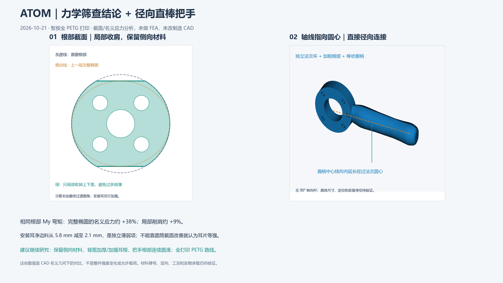
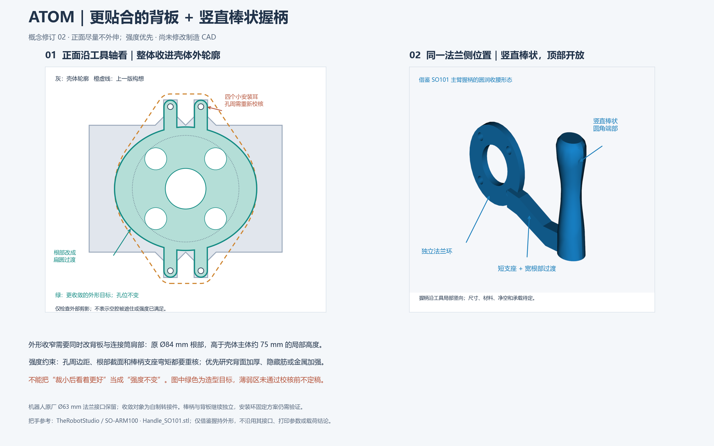
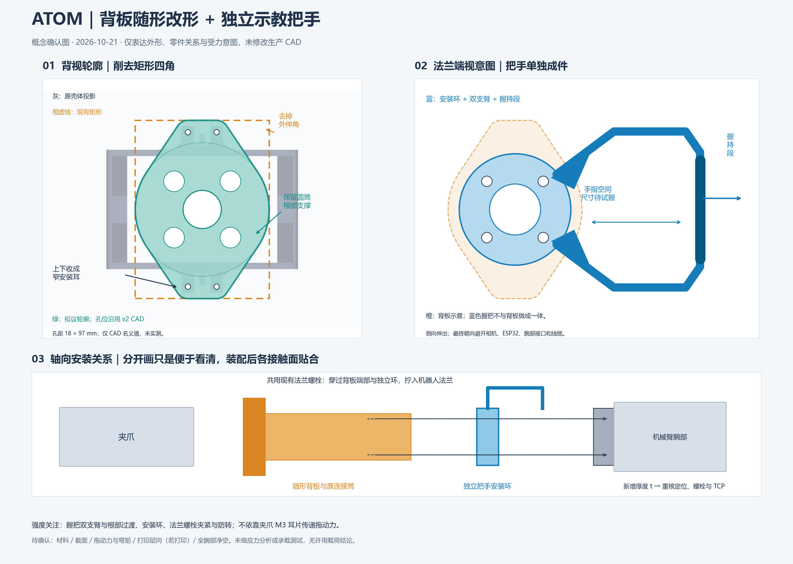

# 背板随形改形与独立示教把手：概念确认

日期：2026-10-21。状态：等待用户确认理解；未修改或生成新的制造 CAD，未定材料、尺寸或承载能力。

## 最新：修订 03 与第一轮力学筛查

用户确认结构件希望全部打印，并将材料从 PLA 更正为疑似 **PETG（原话“好像是 pteg”，品牌/牌号待核对）**。把手方向进一步明确为 **握柄轴线向内延长经过法兰圆心，直接径向布置，去掉 90° 转向杆**。此方向已替代修订 02 的垂直握柄/下部支座。

完成了 [第一轮力学筛查报告](analysis/REPORT.md)、[可复算脚本](analysis/compare_sections.py) 和 [原始计算结果](analysis/results.json)。这是截面几何、名义应力、理想反力分配与敏感性分析，**没有做有限元或实物承载验证**，没有给出允许载荷或安全系数。

主要发现：同一根部绕 Y 弯矩下，完整椭圆的名义弯曲应力比 v2 圆根部约高 38%；若保持同样隐藏高度，仅局部削去上下圆肩、保留两侧材料，增幅约为 9%。这是单截面对比，不是整体强度下降比例。安装耳的孔边材料从 5.8 mm 减至 2.1 mm，需要独立处理，不能靠改善中间筒体就认为等强。

当前建议研究局部削肩与耳根背面加强，在全打印 PETG 路线内先校核孔周和根部，再确定外形最小尺寸。示意把手的安装环厚度与握持尺寸仅为临时渲染参数；定位、共享法兰紧固件、螺钉头/垫圈/工具净空、真实腕部、手部空间及承载未验证。制造 CAD 未修改，没有导出新 STEP/STL。

交付：[修订 PNG](concept_rev03.png)、[修订 SVG](concept_rev03.svg)、[分析报告](analysis/REPORT.md)。材料数据仅参考厂家 PETG 试样资料，不直接当作本零件许用值。下方初稿与修订 02 作为历史记录保留。

## 修订 02（历史）

用户进一步要求正面不见自制法兰/转接件外伸，在强度优先的条件下尽量收敛、改善外形；把手位置保留，改为参考 SO101 主臂的竖直棒状握柄。下方初稿仅作为历史构想保留，D 形把手不再是当前造型。

- **背板外形目标**：主体由圆形肩部改为扁圆过渡，上下四个孔分别保留小安装耳。草图沿工具 X 轴投影，处于原壳体背面外轮廓以内；仅表示外包络不外伸，不表示夹爪空腔能挡住后方零件，也不保证斜视角隐藏。壳体投影内的开口已忽略。
- **圆筒也要收敛**：v2 根部 Ø84 mm，而原壳体主体的局部高度约 75 mm，故原圆肩上下各约 4.5 mm 超出这个局部高度范围。v2 Ø76 mm 圆筒也需要随新外形一起检查，不能仅修改前板。机器人名义 Ø63 mm 法兰接口不削改。
- **孔周是限制**：原壳体耳片 CAD 在孔心外侧的边界为 4 mm；若让新 Ø3.4 mm 孔完全藏在此轮廓内，最窄净边料最多约 2.3 mm，尚未扣制造/装配余量。修订图留 0.2 mm 示意内缩后，草图最窄净边料约 2.1 mm。对比初稿以孔心为中心半径 7.5 mm 的预留区，其净边料为 5.8 mm，收敛明显改变了局部截面。以上均为 CAD 平面几何计算，无实测不确定度，不是许用边距或强度结论。
- **强度优先的含义**：不能承诺直接裁小后与 v2 等强，更不能把未经验证的 v2 当成已合格基准。研究轴向加厚、隐藏加强筋或金属加强的空间，同时核对孔周撕裂/承压、筒体根部、安装耳与原壳体、连接螺栓的整条载荷路径；如果仍无法满足，接受少量外露或调整安装接口，而不是为了隐藏强行削薄。
- **棒柄**：沿工具局部竖向，侧向位置保持；顶部开放、圆角端部、轻微收腰，下部支座接独立法兰环。单端支撑要重新检查根部弯矩和扭转，不能继承先前 D 形双支臂的受力假设。图中环、支座、握柄是临时示意实体，不是定稿；没有导出新 STEP/STL。金属芯、握持外套或全打印方案尚未选定。
- **固定方式**：沿用初稿暂拟的独立环、共用法兰螺栓的表达，用户尚未明确确认该细节。环与背板独立但装配接触；材料、环厚、定位、工具通道、螺栓头/垫圈净空以及腕部全姿态均未验证。

参考已查看原作者仓库的 [Handle_SO101.stl](https://github.com/TheRobotStudio/SO-ARM100/blob/main/STL/SO101/Individual/Handle_SO101.stl) 并下载至 `tmp/backplate_review/Handle_SO101_reference.stl` 作形态检查；另参见 [LeRobot 官方 SO101 文档](https://huggingface.co/docs/lerobot/so101)。仅借鉴圆润棒状握持形态，不移植其小型主臂接口、打印参数、触发机构或承载结论。

交付：[修订 PNG](concept_rev02.png)、[修订 SVG](concept_rev02.svg)、[草图几何记录](concept_rev02_geometry.json)。外轮廓计算基于原 STEP 两壳体在 x=28.8 mm 的背面边界，坐标中心 y=43.494、z=−22.225 mm。草图扁圆 84 × 73 mm、耳片半径 3.8 mm 仅用于绘图和检查，不是制造尺寸选择。临时脚本为 `tmp/backplate_review/draw_concept_rev02.py` 与 `render_handle_rev02.py`。

## 初稿（历史）

## 对需求的理解

1. 背板矩形四角收进去，轮廓贴近夹爪背部；不是只把四个角加小圆角。概念保留中央圆筒根部支撑，上下收窄成安装耳，保留原四孔位置。图中轮廓是几何草图，不是已经校核的裁切线。
2. 在法兰附近增加方便示教拖动的把手，与背板独立制造、可拆卸，握持段与背板留出手指空间。暂按侧向 D 形、双支臂表达，朝向尚未确定。
3. 本图把“两个独立的”解释为两个独立零件，允许在法兰处共用安装界面和紧固件；并不意味着装配后两者完全不接触。此解释仍需用户确认。

## 图中暂定安装方式

轴向关系：夹爪 → 随形背板及连接筒 → 独立把手安装环 → 机器人法兰。把手安装环与背板法兰端夹在同组法兰螺栓中，装配后接触面贴合；握把不与背板一体成形，也不固定在夹爪的小 M3 耳片上。安装环不是靠徒手摩擦套在腕部的卡圈。

这是安装构想，尚未确认可用。增加环厚度会影响中心定位、定位销、有效螺纹啮合、螺钉长度、装配工具通道和工具轴向偏置；不能直接在原零件后加一片环便认为完成。需重核定位凸台与孔、端面夹紧、防滑转及拆装顺序；新增厚度应在实际装配测量后更新工具变换、TCP、质量与重心。

已有官方手册参考页显示标准四 M6 孔之外还有两 M6 孔，但现有背板实体并未提供这两个孔的专用安装/工具通道。本图未假定这两孔可直接用于独立把手，也未把 Ø6 定位孔当作螺纹孔。若用户要求把手拥有完全独立的紧固件，需要另评估这两个孔的真实位置、可达性及背板让位，不能声称本图已满足。

## 几何证据与边界

- [原始夹爪 STEP](../../../hardware/end%20effector/End%20Effector%20Assembly%20V3.step)：只读；概念图灰色背景由其中两壳体的沿 X 轴正交投影生成，包含壳体深度范围，不等同于背部接触面的精确截面。
- [背板 v2 生成脚本](../../../source_cad/backplate/v2/build_backplate.py)及[参数](../../../source_cad/backplate/v2/parameters_and_checks.json)：矩形板 84 × 112 mm、厚 12 mm，圆筒根部 Ø84 mm；四个夹爪孔中心距 18 × 97 mm，孔径 Ø3.4 mm；均为 CAD 名义值，不是实测尺寸。
- [v2 说明](../../../source_cad/backplate/v2/README.md)：法兰接触面 Ø63 mm、四 M6 的 Ø50 mm 分布圆等已有名义参考。当前实体 CAD 有效、无静态相交的历史检查，不代表新构想完成同样检查。
- 原壳体 CAD 两半总体 Z 包络为约 −74.725 至 30.275 mm；当前矩形背板 Z 为 −78.225 至 33.775 mm。削角可以减少两端宽度方向的外伸，但保留孔周材料和 Ø84 mm 根部后，不能承诺所有方向完全齐平。
- 暂拟轮廓由根部圆和安装孔周预留区的凸包表达，仅便于讨论，后续需完成圆滑过渡、真实孔边距及截面检查。
- 法兰参考：已存档 UF850 User Manual V2.3.0，第 25–26 页；它是接口参考，不替代交付实物验证。图中腕部不是供应商完整 CAD。

## 强度与后续工作

重点检查手柄横向拉力、推力、扭转及偏心弯矩下的支臂根部、安装环、螺栓组、接触面滑移和塑料承压/蠕变。把手材料及背板材料应分别评估；不能直接沿用此前暂定 PLA 并认定把手可承载。若采用打印件，还需按实际打印方向和层间性能评估。

用户确认外形与独立安装的含义后，再测定/约定拖动力、力臂和载荷工况，完成材料和截面设计、装配干涉检查及受控工装上的载荷/位移测试。当前未开展有限元或实物测试，无许用力、许用弯矩或安全系数结论。新增把手也不证明机械臂示教功能或设置已验证；实际安装后需重新核对工具负载、重心及安装方向等参数。

图中所有把手比例均为示意；握持长度、指间净空、环厚及支臂截面未定。相机、ESP32、腕部接口、线缆弯曲与全姿态空间尚未验证。

交付：[PNG](concept.png)、[可缩放 SVG](concept.svg)。绘图过程位于 `tmp/backplate_review/draw_concept_20261021.py`；无新 STEP/STL。
